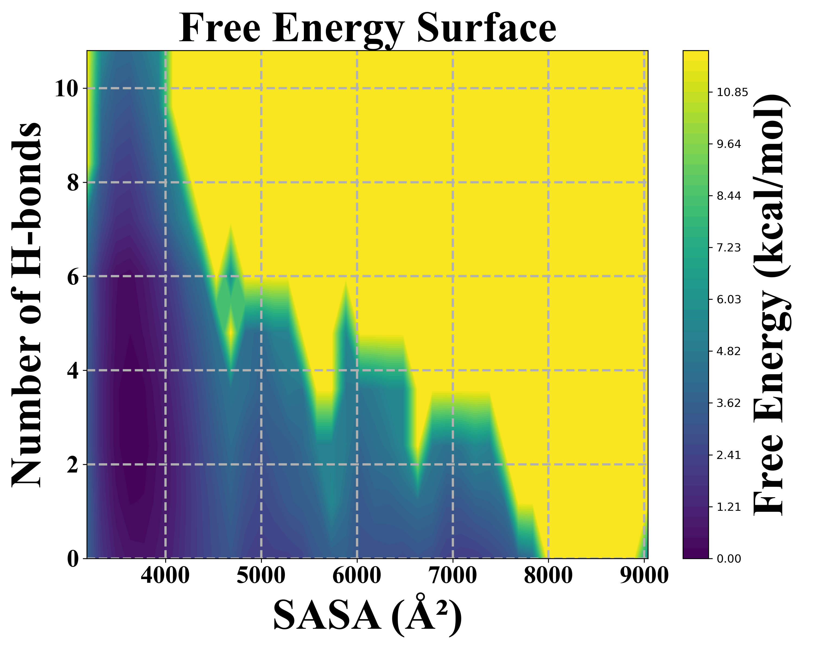
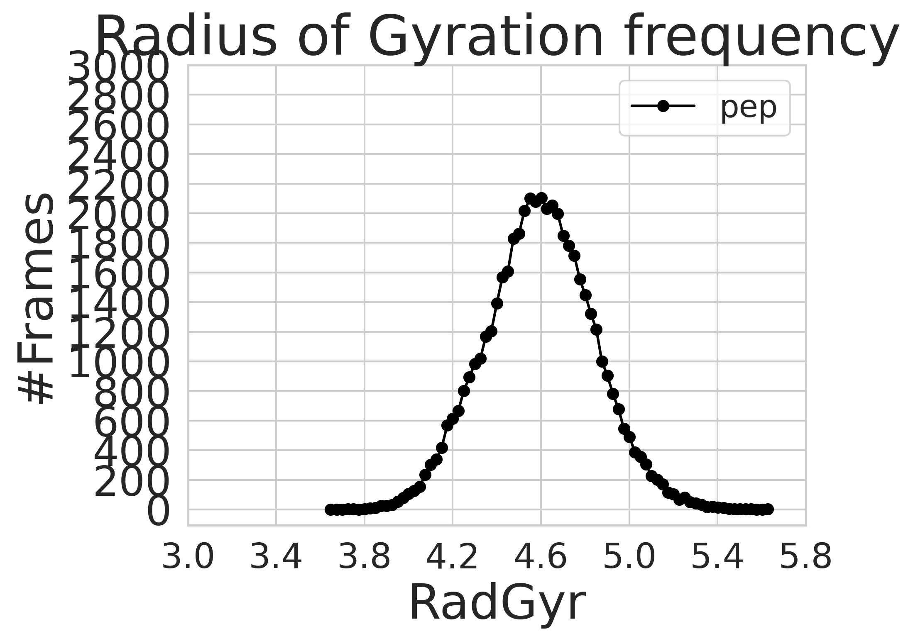

# Molecular Dynamics Analysis — Peptide Self-Assembly & Aggregation

[](LICENSE)
[](https://www.python.org/)
[](https://ambermd.org/)

Analysis scripts, CPPTRAJ inputs, and SLURM jobs from my Ph.D. work on **peptide self-assembly and aggregation** at the University of Milan (NanoReMedi Doctoral Network, EU-funded). The focus is on atomistic characterisation of peptide–dye conjugates using classical and accelerated MD (aMD) simulations, with post-processing done in CPPTRAJ and Python.

---

## Research Context

The system studied is a boron-dipyrromethene (BDP)–peptide conjugate, **D1Cl1**, simulated in explicit solvent. Classical MD can't easily sample the slow conformational transitions relevant to self-assembly, so aMD is used to flatten the energy surface and accelerate sampling. All simulations run with **AMBER 24**; trajectory analysis and observables are computed with **CPPTRAJ** and the scripts in this repo.

The observables tracked are H-bond formation over time, backbone and side-chain dihedral dynamics, π–π stacking between the BDP and RFP aromatic groups, intermolecular BDP–RFP distances, RMSD, radius of gyration, solvent-accessible surface area (SASA), conformational clustering, and PCA of the conformational landscape.

---

## Repository Contents

### Python Analysis Scripts

| Script | Description |
|--------|-------------|
| `H-bond.py` | H-bond count vs. frame (CPPTRAJ output → PNG) |
| `diheral.py` | Dihedral angle time series for BDP and RFP planes |
| `script.py` / `pca.py` | 3-D PCA probability density surface (Gaussian KDE) |
| `Free_energy.py` | Free energy surface from simulation data |
| `radgyr.py` | Radius of gyration analysis and plotting |
| `rmsd.py` | RMSD time series analysis |
| `sasa.py` | Solvent-accessible surface area analysis |
| `D_vs_T.py` | Distance vs. temperature (T-REMD analysis) |
| `frequency.py` | Frequency/histogram analysis |
| `graph.py` / `launch_plot.py` | General-purpose plotting helpers |
| `bdp.py` | BDP chromophore-specific analysis |
| `cube.py` | Gaussian cube file utilities (MO visualisation) |
| `packmol.py` | PACKMOL input file generation helper |

### CPPTRAJ Input Files (`.traj` / `.in`)

| File | Purpose |
|------|---------|
| `H-Bond.traj` | Intermolecular H-bond counting |
| `Dihedral_Angle.traj` | Dihedral angle time series |
| `BDP-RFP-distance.traj` | BDP–RFP intermolecular distance |
| `pi_pi_Stacking.traj` | π–π stacking distance |
| `cluster.traj` | Conformational clustering |
| `combine.traj` | Trajectory concatenation |
| `radgyr.traj` | Radius of gyration |
| `rmsd.traj` / `rmsd.in` | RMSD calculation |
| `sasa.traj` / `sasa.in` | Solvent-accessible surface area |

### SLURM / Shell Job Scripts

| Script | Purpose |
|--------|---------|
| `launch-aMD.sh` | Submit aMD production run (`pmemd.MPI`) |
| `launch-MD.sh` | Submit standard MD run |
| `launch_aMD_plus_analysis.sh` | aMD run + CPPTRAJ analysis (chained) |
| `launch_aMD_implicit_plus_analysis.sh` | Implicit solvent aMD + analysis |
| `re-launch_aMD_plus_analysis.sh` | Restart aMD + analysis |
| `analysis.sh` | Run CPPTRAJ analysis batch |
| `chained_tremd_slurm.sh` | Chained T-REMD SLURM submission |
| `equil_and_first_remd.slurm` | Equilibration + first REMD run |
| `gaussian.slurm` | Gaussian DFT job script |
| `rms.sh` | Quick RMSD shell script |
| `do_all_MD_GPU_5.4.2.csh` | Full MD workflow (GPU, explicit solvent) |
| `do_all_MD_implicit_GPU_5.4.2.csh` | Full MD workflow (GPU, implicit solvent) |

### AMBER / MD Input Files

| File | Purpose |
|------|---------|
| `h-remd.in` / `remd.mdin` | REMD simulation parameters |
| `leap.in` | System preparation (tleap) |
| `reduce.in` | Hydrogen addition (reduce) |
| `groupfile` / `remd.groupfile` | AMBER groupfiles for multi-run |
| `setup_equilibrate_input.x` | Equilibration input generator |
| `setup_remd_input.x` | REMD input generator |

### PACKMOL Inputs

| File | Description |
|------|-------------|
| `8x8.inp` | 8×8 peptide array packing |
| `8x8x8.inp` | 8×8×8 peptide array packing |
| `10_molecules.inp` | 10-molecule initial configuration |

### Perl Utilities

| Script | Purpose |
|--------|---------|
| `iterative_aMD.pl` | Automate iterative aMD boost parameter tuning |
| `check_file_difference.pl` | Verify trajectory file consistency |
| `check_num_frames.pl` | Count frames across trajectories |
| `print_dihedrals.pl` | Extract dihedral data |
| `renumber.pl` | Renumber residues/atoms |
| `strip_trajectories_by_list.pl` | Strip trajectory by residue list |

### Data & Figures

| File | Description |
|------|-------------|
| `temperature.dat` | Temperature data (T-REMD output) |
| `free_energy_surface.png` | Free energy landscape |
| `radgyr_frequency.png` | Radius of gyration distribution |
| `D1Cl2.png` | D1Cl2 system structure |
| `LUMO-179-conf-1.tif` | LUMO orbital (Gaussian/DFT output) |

---

## Dependencies

### Software
| Tool | Version | Purpose |
|------|---------|---------|
| AMBER / pmemd.MPI | 24 | MD simulation engine |
| CPPTRAJ | bundled with AMBER 24 | Trajectory analysis |
| Gaussian | 16 / 09 | DFT calculations |
| PACKMOL | latest | Initial structure packing |
| Python | ≥ 3.8 | Analysis & plotting |

### Python Packages
```bash
pip install -r requirements.txt
```

---

## Usage Examples

### H-bond Analysis
```bash
python H-bond.py                          # default input: intermol_hbonds.dat
python H-bond.py --input my_hbonds.dat   # custom input
python H-bond.py --output my_plot.png     # custom output
```

### CPPTRAJ Analysis
```bash
cpptraj -i H-Bond.traj
cpptraj -i cluster.traj
cpptraj -i BDP-RFP-distance.traj
cpptraj -i rmsd.traj
cpptraj -i sasa.traj
```

### Submit aMD Job (SLURM)

Edit the configuration block at the top of `launch-aMD.sh`:
```bash
AMBER_HOME=/path/to/amber24
DIR=/path/to/your/project
name=D1Cl1
ACCOUNT=your_hpc_account
```
Then:
```bash
sbatch launch-aMD.sh
```

---

## Example Output

### Free Energy Surface


### Radius of Gyration Distribution


---

## Citation

If you use these scripts, please cite:

> Ahmed Saeed. *Peptide Self-Assembly and Aggregation: Atomistic Simulations of Peptide–Dye Conjugates.* Ph.D. Thesis, Università degli Studi di Milano, Italy & Universitat Politècnica de Catalunya, Barcelona, Spain, 2026.

---

## Author

**Ahmed Saeed**  
Marie Skłodowska-Curie Doctoral Fellow  
Università degli Studi di Milano, Italy & Universitat Politècnica de Catalunya, Barcelona, Spain  
📧 saeed.ahmed@unimi.it  
🔗 [ORCID](https://orcid.org/0009-0003-9717-5180) · [Google Scholar](https://scholar.google.com/citations?user=GkT5UZUAAAAJ&hl=en) · [LinkedIn](https://www.linkedin.com/in/ahmed-saeed-833a74157)

---

## License

This project is licensed under the MIT License — see the [LICENSE](LICENSE) file for details.
